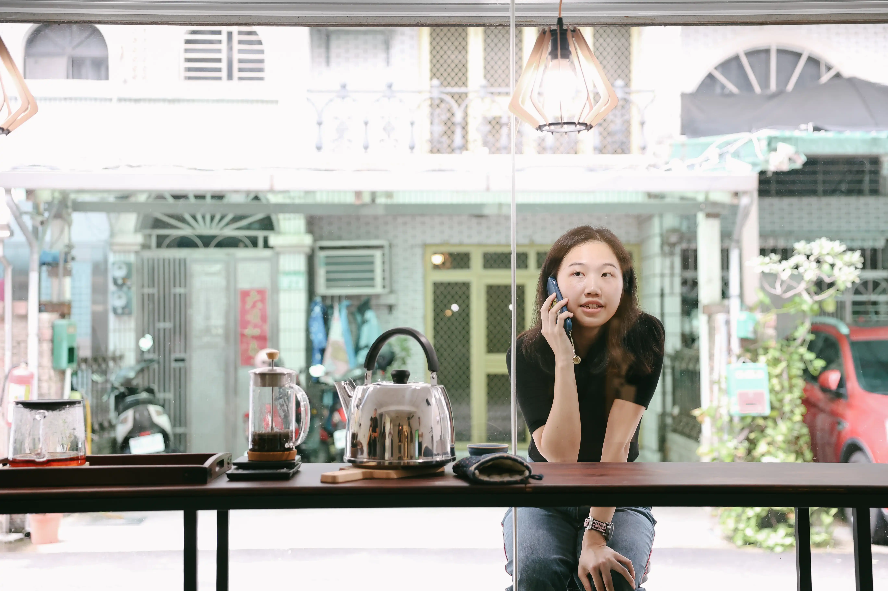

+++
date = '2026-04-05T00:16:04+11:00'
draft = false
title = 'About'
+++

#### 林沛瑤 LIN Pei-Yao

藝術創作暨研究者，生於臺灣臺中，畢業於國立臺北藝術大學美術學系碩士班。創作實踐以媒體藝術、空間裝置與表演為主，藉由肉身與科技媒介交織的感知經驗，以創作探究自我意識與時間感知在不同情境中的變異。曾於金車文藝中心、洪建全基金會與众藝術舉辦個展。過往作品曾展出於台北當代藝術館（2024）、府中15（2025） 等，並曾獲得高雄獎影像暨科技媒體藝術類優選（2024）、台新藝術獎第23屆第二季提名入圍（2024）。在創作之外以寫作為打磨觀點與創作研究之方法，文章散見於《SCREEN 介面》、《CLABO實驗波》、《典藏ARTouch》、《藝術圈圈diArtlogue》、《台新ARTalks》等平台。

E-mail: peiyao@protonmail.com

